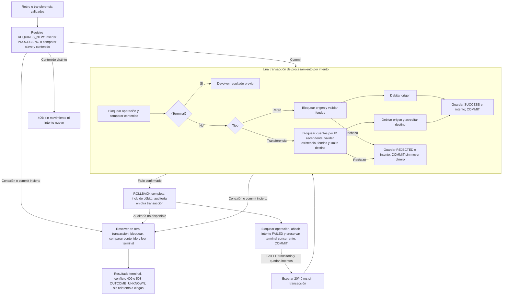

# Flujos de retiro y transferencia

El orquestador usa `Propagation.NEVER`: no engloba toda la solicitud en una transacción.
Las llamadas entre componentes Spring pasan por proxies y crean transacciones separadas.
Los bloqueos se liberan al confirmar o revertir. Véase la [nota técnica](technical-note.md).



Un contenido distinto también corta el procesamiento con 409. SUCCESS, REJECTED y FAILED no
reintentable son terminales. FAILED reintentable puede procesarse de nuevo, pero no confirma
un resultado terminal para la resolución de incertidumbre. Los intentos no son movimientos:
solo `operations` con SUCCESS afecta la conciliación.

Hay como máximo **tres intentos totales** por llamada, solo tras rollback confirmado con
40P01 (deadlock), 40001 (serialización) o 55P03 (espera de bloqueo agotada). Otros fallos dejan
FAILED / PROCESSING_FAILURE; el agotamiento transitorio deja FAILED / TRANSIENT_CONFLICT.
La interrupción detiene el reintento y restaura su marca. Una solicitud posterior conserva
la misma clave; nunca vuelve a aplicar un movimiento confirmado.

SQLSTATE 08 y excepciones del límite transaccional activan resolución. Otro fallo de registro
devuelve SERVICE_UNAVAILABLE antes de procesar. Si no se puede confirmar un terminal, se
responde OUTCOME_UNKNOWN. Una caída puede perder auditoría de fallos y dejar PROCESSING o
un FAILED reintentable anterior. No hay recuperación en segundo plano ni inyección pública de fallos.

`FINANCIAL_LOCK_TIMEOUT_MS` vale 1000 por defecto; acepta 1–60000, fuera de ese rango falla
el arranque. `set_config` parametrizado aplica lock_timeout local a cada transacción.
No limita toda la solicitud HTTP ni fallos de red; Hikari tiene su propia espera de conexión.

## Conciliar desde SQL

En una instantánea consistente, esta consulta debe devolver cero filas:

```sql
SELECT a.id, a.balance,
       a.initial_balance
       - COALESCE((SELECT SUM(o.amount) FROM operations o
                   WHERE o.status = 'SUCCESS' AND o.source_id = a.id), 0)
       + COALESCE((SELECT SUM(o.amount) FROM operations o
                   WHERE o.status = 'SUCCESS' AND o.kind = 'TRANSFER'
                     AND o.destination_id = a.id), 0) AS expected_balance
FROM accounts a
WHERE a.balance <> a.initial_balance
       - COALESCE((SELECT SUM(o.amount) FROM operations o
                   WHERE o.status = 'SUCCESS' AND o.source_id = a.id), 0)
       + COALESCE((SELECT SUM(o.amount) FROM operations o
                   WHERE o.status = 'SUCCESS' AND o.kind = 'TRANSFER'
                     AND o.destination_id = a.id), 0);
```

Las [pruebas](test-results.md) verifican esta igualdad para todas las cuentas y el total.
