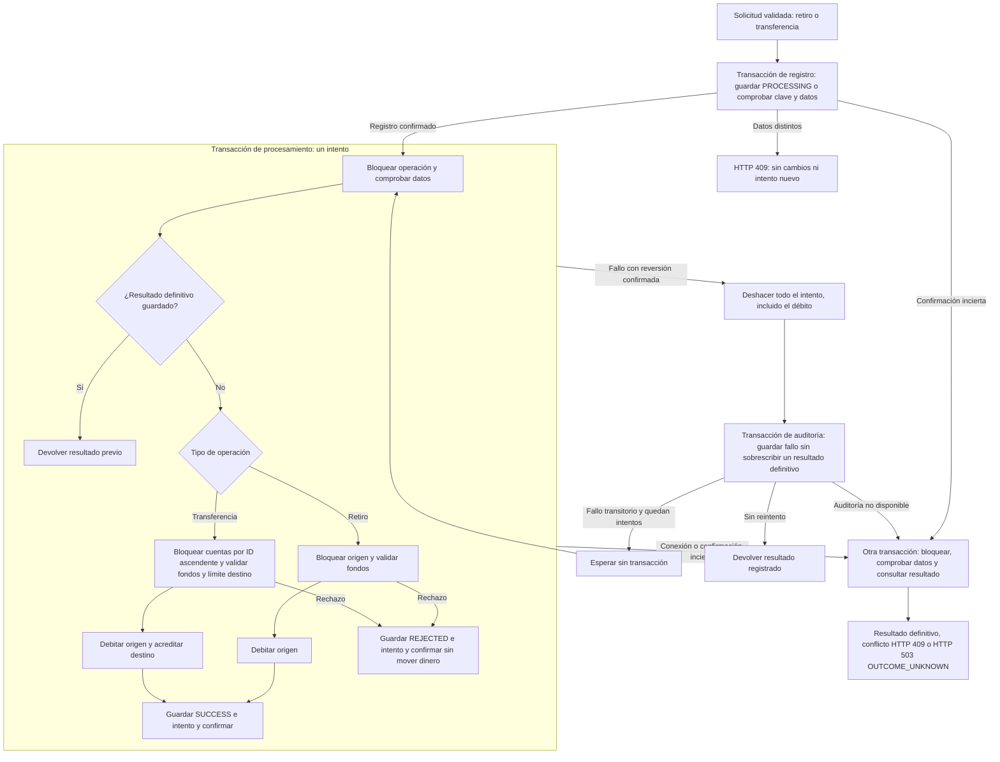

# Flujos de retiro y transferencia

La solicitud pasa por transacciones separadas de registro, procesamiento y, si corresponde,
auditoría del fallo. El orquestador no mantiene una transacción abierta entre ellas.
Los bloqueos se liberan al confirmar o revertir cada transacción.



Un fallo revierte los cambios del intento antes de registrar su auditoría. Solo los errores
40P01, 40001 y 55P03 permiten reintentos automáticos: como máximo tres intentos totales por
llamada, con esperas de 20 y 40 ms. No son tres reintentos obligatorios.

SUCCESS, REJECTED y FAILED no reintentable son definitivos. Un FAILED reintentable permite
otro intento, pero no resuelve una confirmación incierta. Una clave con otros datos también
produce HTTP 409 durante el procesamiento.

Cuando no se puede confirmar el resultado, se devuelve OUTCOME_UNKNOWN sin repetir el
movimiento a ciegas. Otro fallo de registro devuelve SERVICE_UNAVAILABLE antes de procesar.
El cliente debe conservar la misma clave. La auditoría separada no garantiza registrar fallos
si la aplicación cae o la base no está disponible; no hay recuperación en segundo plano.

`FINANCIAL_LOCK_TIMEOUT_MS` limita la espera de bloqueo: por defecto 1000 ms, con valores
admitidos de 1 a 60000. Un valor fuera del rango impide el arranque. Se aplica localmente a
cada transacción, no al tiempo total de la solicitud ni a los fallos de red. La espera de
conexión de Hikari se configura por separado.

## Conciliar desde SQL

Conciliar significa comprobar que los saldos coincidan con los movimientos confirmados.
En una instantánea consistente, esta consulta debe devolver cero filas:

```sql
SELECT a.id, a.balance,
       a.initial_balance
       - COALESCE((SELECT SUM(o.amount) FROM operations o
                   WHERE o.status = 'SUCCESS' AND o.source_id = a.id), 0)
       + COALESCE((SELECT SUM(o.amount) FROM operations o
                   WHERE o.status = 'SUCCESS' AND o.kind = 'TRANSFER'
                     AND o.destination_id = a.id), 0) AS expected_balance
FROM accounts a
WHERE a.balance <> a.initial_balance
       - COALESCE((SELECT SUM(o.amount) FROM operations o
                   WHERE o.status = 'SUCCESS' AND o.source_id = a.id), 0)
       + COALESCE((SELECT SUM(o.amount) FROM operations o
                   WHERE o.status = 'SUCCESS' AND o.kind = 'TRANSFER'
                     AND o.destination_id = a.id), 0);
```

Solo las operaciones SUCCESS afectan el saldo. Los intentos y los rechazos no se suman como
movimientos. Las [pruebas](test-results.md) verifican esta igualdad por cuenta y el saldo total.
La [nota técnica](technical-note.md) explica las decisiones y sus límites.
